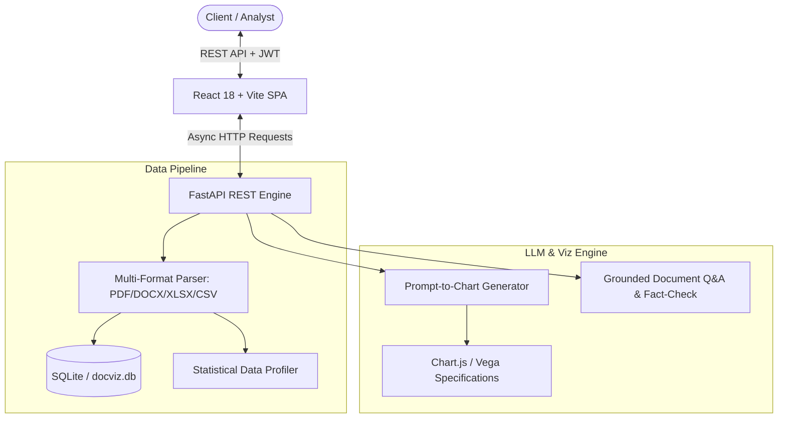

# ⚡ DocFusion — Multi-Format Document Intelligence & Visualization Platform

<div align="center">

[](https://react.dev)
[](https://fastapi.tiangolo.com)
[](https://www.typescriptlang.org)
[](https://python.org)
[](https://tailwindcss.com)
[](https://sqlite.org)
[](LICENSE)
[](https://github.com/SparkSidd)

**Unified Document Intelligence, Automated Chart Synthesis, and Conversational Grounded Analysis.**  
*Prompt-to-Chart Synthesis · Multi-Format File Parsing (PDF, DOCX, CSV, XLSX) · Real-Time Visual Q&A · Fact-Checking Engine*

[Overview](#-overview) • [Architecture](#-system-architecture) • [Features](#-key-capabilities) • [Tech Stack](#-technical-stack) • [Quick Start](#-quick-start)

</div>

---

## 📌 Overview

DocFusion is an enterprise document intelligence and analytical dashboard that fuses automated tabular data extraction with LLM reasoning. Rather than reading static reports or manually writing data visualization scripts, users upload complex multi-page files (PDF, DOCX, Excel, CSV) and interact through an intelligent prompt-to-chart visualization pipeline.

---

## 🚀 Key Capabilities

- **📄 Universal Document Ingestion**: Seamless parser pipeline for `.pdf`, `.docx`, `.xlsx`, `.csv`, and `.txt` files.
- **📊 Prompt-to-Chart Engine**: Converts natural language prompts into reactive Chart.js / Recharts visualizations automatically.
- **🔍 Grounded Document Q&A**: Context-aware retrieval engine extracting verbatim citations and verifying claims against raw text.
- **🛡️ JWT Authentication & Session Isolation**: Secure multi-user document workspaces with RBAC boundaries.
- **📈 Analytical Data Profiling**: Automatically computes skewness, statistical correlations, missing value heatmaps, and outlier flags upon upload.

---

## 🏗️ System Architecture



---

## 🛠️ Technical Stack

| Category | Technology |
| :--- | :--- |
| **Frontend** | React 18, TypeScript 5.5, Vite, Tailwind CSS, TanStack Query, Zustand |
| **Backend** | Python 3.11+, FastAPI (Async), Pydantic v2, Uvicorn |
| **ORM & Storage** | SQLAlchemy, SQLite (`docviz.db`), Multi-part file upload streaming |
| **Data & Plotting** | Pandas, NumPy, Matplotlib, Recharts |
| **Security** | OAuth2 with Password Flow, JWT bearer tokens, bcrypt hashing |

---

## ⚡ Quick Start

### 1. Clone & Setup Backend
```bash
cd DocFusion/backend
python -m venv venv
source venv/bin/activate  # Windows: venv\Scripts\activate
pip install -r requirements.txt
uvicorn app.main:app --reload --port 8000
```

### 2. Frontend Setup
```bash
cd ../frontend
npm install
npm run dev
```

Navigate to `http://localhost:5173`. Use demo credentials or register a local tenant.

---

## 📄 License
This project is open-source under the MIT License.
